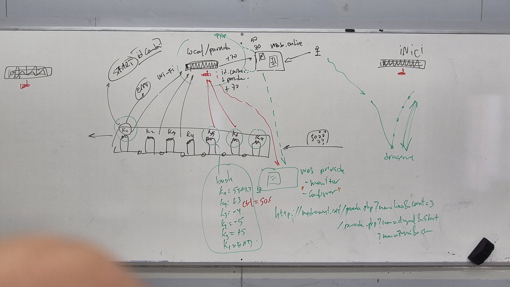
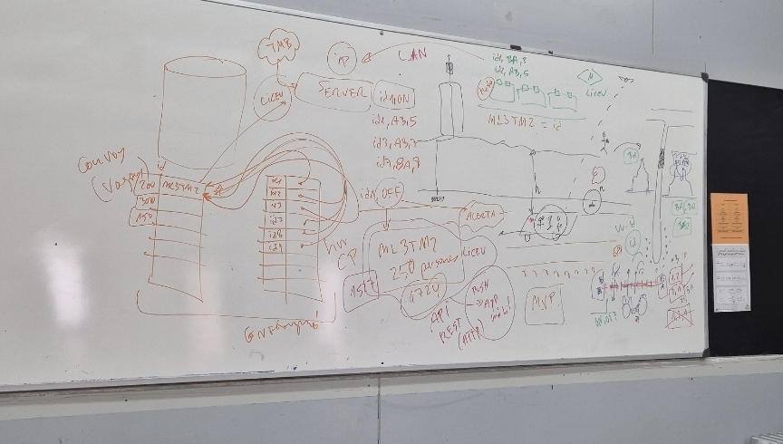
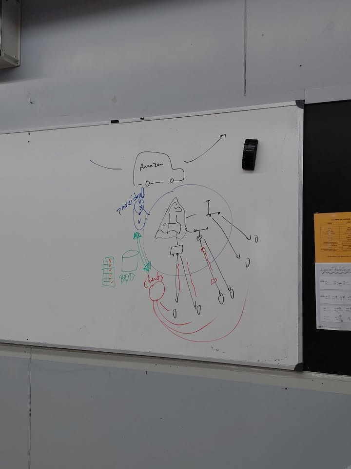
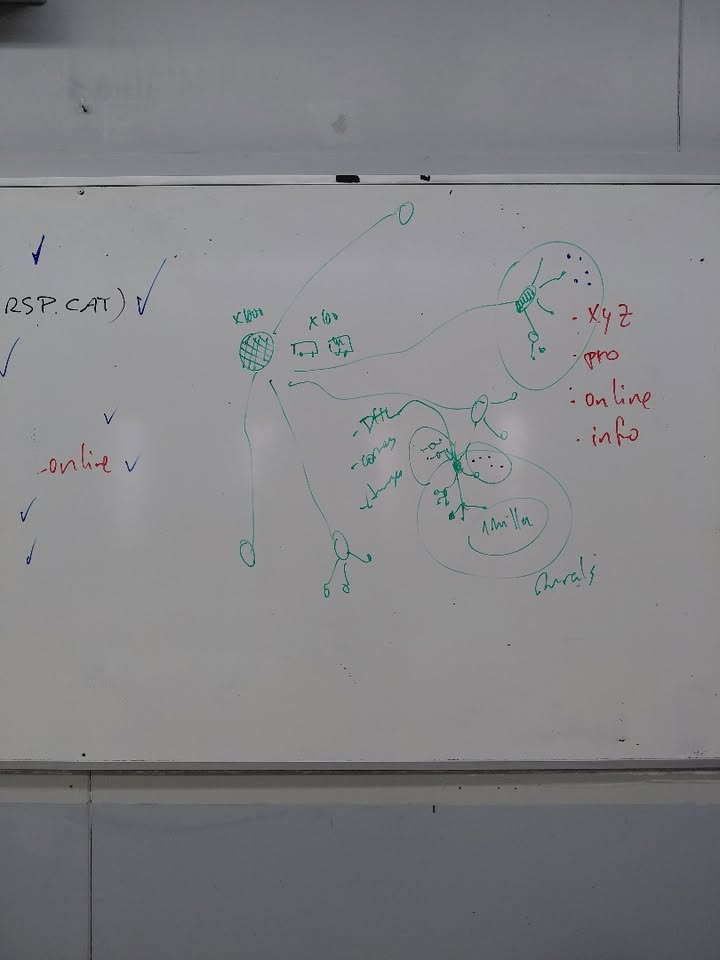
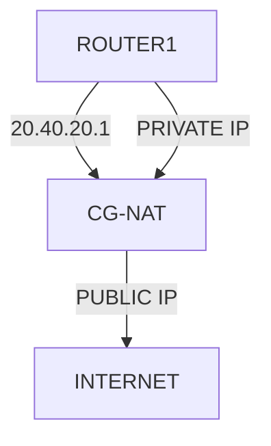
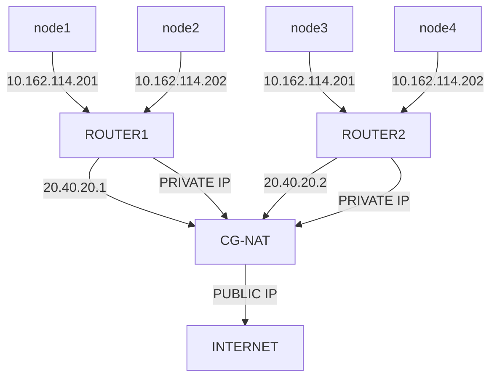
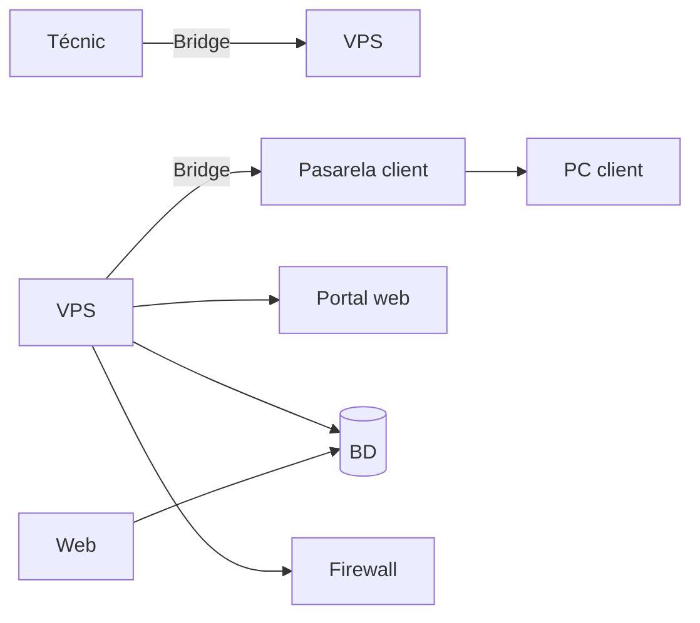
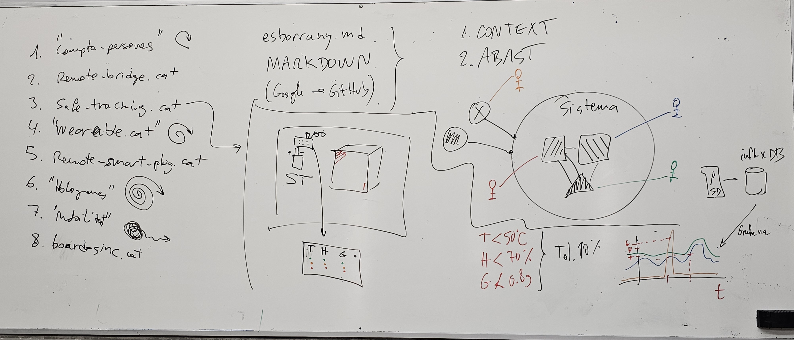

# REPO projecte-smx2b-2026-2027

Llista de projectes d'SMX2B del curs 2026-2027.

  - [BoardSinc](#BoardSinc), [boardsinc.cat](https://boardsinc.cat)
  - [HoloTech360](#HoloTech360), [holotech360.cat](https://holotech360.cat)
  - [MetroCount](#Metrocount), [metrocount.cat](https://metrocount.cat)
  - [PackGo](#PackGo), [packgo.cat](https://packgo.cat)
  - [RBridge](#RBridge), [rbridge.cat](https://rbridge.cat)
  - [Remote-Smart-Plugs](#Remote-Smart-Plugs), [remote-smart-plugs.cat](https://remote-smart-plugs.cat)
  - [SafeTracking](#SafeTracking), [safetracking.cat](https://safetracking.cat)
  - [WearSafe](#WearSafe), [wearsafe.cat](https://wearsafe.cat)

### [BoardSinc](https://github.com/Khania93/BoardSinc)

###### Context i situació inicial:

La comunitat de wargame (jocs de taula o de miniatures en què dos o més jugadors simulen conflictes militars, batalles històriques o situacions tàctiques i estratègiques) es troba amb diverses dificultats a l'hora de preparar i desenvolupar una partida.

Un dels principals inconvenients d'aquest tipus de jocs és la necessitat de disposar d'un espai físic considerable per representar els escenaris, desplegar les miniatures i gestionar els diferents elements que intervenen en una partida. Això, sumat a la quantitat de material necessari, pot dificultar-ne la pràctica, especialment en entorns domèstics o en espais amb disponibilitat limitada.

A més, la preparació de les partides sovint requereix un temps considerable, tant per al muntatge de l'escenari com per a la configuració de les unitats, la consulta de regles i la gestió dels diferents elements del joc. Aquesta complexitat també representa una barrera d'entrada per als nous jugadors, que poden trobar dificultats a l'hora d'aprendre les mecàniques, comprendre les regles i familiaritzar-se amb les diferents unitats i les seves característiques.

Tot i aquestes dificultats, un dels principals atractius dels wargames és precisament l'experiència física i tàctil que ofereixen. La manipulació de miniatures, el desplegament de les unitats sobre el terreny de joc i l'ús de daus per resoldre les accions formen part essencial de la seva identitat i contribueixen a generar una experiència immersiva, estratègica i social que molts jugadors volen preservar.

En aquest context, BoardSinc sorgeix amb l'objectiu de simplificar i fer més accessible l'experiència dels jocs de wargame, abordant les principals dificultats relacionades amb l'espai necessari, el muntatge i la configuració de les unitats, així com la iniciació de nous jugadors. Tot això, mantenint com a eix central l'ús de miniatures i daus, per preservar al màxim les sensacions, les dinàmiques i l'essència dels jocs de guerra tradicionals.

Així, el projecte busca trobar un equilibri entre la simplificació de la preparació i el desenvolupament de les partides i la conservació de l'experiència física i estratègica que caracteritza aquesta afició.

###### Abast i objectius:

Objectius generals L'objectiu principal de BoardSinc és digitalitzar tots els elements dels jocs de wargame que no siguin miniatures ni daus, amb la finalitat de simplificar i agilitzar el desenvolupament de les partides, reduir l'espai físic necessari i facilitar l'accés a nous jugadors. El projecte busca combinar els avantatges de les eines digitals amb l'experiència física dels jocs de miniatures tradicionals, mantenint la interacció directa amb les miniatures i els daus com a eixos centrals del joc. D'aquesta manera, es pretén reduir la quantitat de material físic necessari i les tasques de gestió associades, sense perdre l'essència tàctica, estratègica i social dels wargames.

###### Objectius específics

Centralitzar els elements del joc: desenvolupar una aplicació, plataforma web o eina digital que permeti reunir en un únic entorn tots els recursos necessaris per jugar, com ara cartes, fitxes (tokens), manuals, taules de referència i altres elements.
Digitalitzar les cartes i els tokens: substituir els components físics de gestió per versions digitals que permetin consultar la informació, gestionar-ne l'estat i accedir-hi de manera ràpida i intuïtiva.
Agilitzar la gestió de les unitats: facilitar la consulta i l'administració de les característiques, habilitats, estadístiques i estats de les diferents unitats durant la partida.
Facilitar l'accés a les regles i als manuals: integrar la documentació i les referències necessàries dins la plataforma per evitar consultes constants a manuals físics i reduir les interrupcions durant el joc.
Simplificar la preparació de les partides: reduir el temps necessari per organitzar els elements, configurar les unitats i preparar els recursos abans de començar a jugar.
Reduir l'espai físic necessari: disminuir la quantitat de material que cal disposar sobre la superfície de joc, mantenint únicament les miniatures, els daus i els elements físics que siguin imprescindibles.
Facilitar la iniciació de nous jugadors: oferir una interfície intuïtiva i una presentació clara de la informació que permetin comprendre les regles i les mecàniques de joc de manera progressiva.
Preservar l'experiència tradicional: mantenir les miniatures i els daus físics com a elements fonamentals, conservant la manipulació, la interacció i les decisions estratègiques pròpies dels wargames.

###### Abast del projecte

BoardSinc inclou el disseny i el desenvolupament d'una eina digital que actuï com a complement dels jocs de wargame tradicionals. Aquesta eina ha de permetre gestionar els diferents elements del joc des d'un únic entorn, facilitant-ne la consulta i l'administració durant totes les fases de la partida.

### [HoloTech360](https://github.com/Nico-Frias/HoloTech360)

#### Projecte Hologrames
En aquest projecte, el que volem fer és implementar nu sistema d'holoframes que es pugui utilitzar en diferents situacions, ja sigui en l¡àmbit acadèmic, personal o empresarial.

Amb els hologrames volem facilitar diferents tasques, com visualtizar productes en tres dimensions, disposar d'un professor virtual que expliqui contignuts o tenir un assistent informàtic que ajudi a detectar problemes en un ordinador.

El nostre projecte es dirà HoloTech360 i consistirà en una plataforma que integrarà tres funcionalitats diferents dins d'una maetixa pàgina web.

Aquestes funcionalitats seran:

- HoloHelp: assistent virtual per detectar i explicar problemes informàtics

- HoloClass: professor virtual per ajudar en l'aprenentatge.

- HoloStore: visualitzador hologràfic de productes i components informàtics.

La nostra idea és que les tres funcionalitats es puguin utilitzar amb un mateix dispositiu hologràfic, sense necessitat de construir-ne un de diferent per a cada funció.

##### 2. Objectius del projecte

L'objectiu principal és crear un sistema hologràfic interactiu que combini diferents coneixements que hem après durant el cicle de Sistemes Microinformatics i Xarxes locals. (SMX)

Els nostres objectius són (poden ser modificats):

- Construir una piràmide hologràfica utilitzant materials transparents. (o potser el ventilador, ho hem de decidir)

- Crear una pàgina web que permeti controlar les diferents funcionalitats.

- Implementar un sistema de diagnòstic informàtic.

- Desenvolupar un professor virtual amb continguts educatius.

- Crear un catàleg de productes informàtics que es puguin visualitzar en 3D.

- Connectar el sistema hologràfic amb un ordinador.

- Aplicar coneixements de hardware, software, xarxes i programació.

- Documentar tot el procés de desenvolupament i les proves realitzades.

##### 3. Funcionament general
El projecte estarà format per una pàgina web principal anomenada HoloTech360.

Des d'aquesta pàgina, l'usuari podrà seleccionar una de les tres funcionalitats disponibles.

Quan l'usuari seleccioni una opció, el sistema enviarà la informació al programa encarregat de controlar la visualització hologràfica.

Per aconseguir l'efecte hologràfic, utilitzarem una pantalla i una piràmide transparent que reflectirà les imatges preparades per a aquest sistema.

D'aquesta manera, podrem representar objectes, components informàtics o personatges virtuals.

Cal tenir en compte que aquest sistema no genera hologrames reals, sinó un efecte visual mitjançant el reflex de les imatges sobre una superfície transparent.

#### 4. HoloClass — Professor virtual
HoloClass serà la part educativa del nostre projecte.

La idea és crear un professor virtual que pugui explicar diferents temes mitjançant animacions i representacions hologràfiques.

Aquesta funcionalitat estarà pensada especialment per a estudiants, però també podria utilitzar-se en altres àmbits educatius.

###### 4.1. Continguts educatius
Inicialment volem centrar-nos en continguts relacionats amb el nostre cicle formatiu.

Alguns exemples serien:

Components d'un ordinador.

Funcionament del processador.

Memòria RAM.

Discos d'emmagatzematge.

Xarxes informàtiques.

Adreces IP.

Sistemes operatius.

Seguretat informàtica.

Muntatge i manteniment d'ordinadors.

###### 4.2. Funcionament de HoloClass
L'usuari entrarà a la pàgina web i seleccionarà HoloClass.

A continuació, podrà escollir el tema que vol aprendre.

Per exemple, si selecciona "Components d'un ordinador", el sistema podria mostrar una representació hologràfica d'una placa base i destacar els diferents components.

També volem afegir explicacions escrites i, si és possible, narracions d'àudio.

D'aquesta manera, l'alumne podria escoltar l'explicació mentre observa el component representat.

###### 4.3. Possibles ampliacions
En un futur, podríem implementar:

Preguntes tipus test.

Exercicis interactius.

Diferents nivells de dificultat.

Explicacions amb veu.

Un assistent que respongui preguntes sobre els continguts.

Aquestes funcions serien ampliacions, ja que primer volem aconseguir que la visualització hologràfica i la selecció dels continguts funcionin correctament.

### [Metrocount](https://github.com/huporu/Metrocount)

Desenvolupament d'una aplicacio per saber la quantitat que tan ple va el metro de Barcelona

##### Links

[Documentació de la API de TMB "Incluyent autobusos"](https://developer.tmb.cat/api-docs/v1 )

[Més dades per consultar de la API de TMB"](https://developer.tmb.cat/data)

##### Context

La nostra idea és fer-hi en Python una demostració de com es podria fer un comptador de persones en els vagons del metro de Barcelona perquè així a través d'una aplicació es pogués consultar que tan ocupat va el metro i llavors els passatgers poguessin decidir si és convenient entrar o no al vagó

##### Com es fara?

Resumidament, el que teníem pensat nosaltres és implementar uns sensors just a la porta dels vagons del metro perquè així compti les persones que hi passen, la nostra forma que havíem pensat d'implementar els sensors es tractaria de dos sensors, un que s'encarregui de comptar els que entren i l'altre dels que surten, si és possible fer els sensors s'actualitzin de manera ràpida i freqüent (cada 0,5 segons per exemple), i que els infrarojos sàpiguen diferenciar quan passen persones i quan no.  

(D'Aquest tema s'hi ha en parlaré en un altra secció sobre els que se'ns queda fora de l'abast i quins problemes podrien sorgir)

##### Problemes i fora d'abast

Els problemes d'abast en els quals ens podríem arribar a trobar és la precisió d'aquestes dades, un dels principals reptes d'aquest projecte és que les dades no podran ser 100% precises, ja que podrien sorgir problemes com que hi ha una avalancha de persones que entrin juntes al vagó i que el sensor compta com si hagués entrat una persona, però en realitat hi ha entrat dues o tres persones o inclús més.  

També en la part de recollida de dades els repetidors de wifi que hi ha que serveixen per enviar les dades cap al servidor sobre les persones podria fallar per culpa de l'alta demanda de persones que estiguessin utilitzant la xarxa 

Per això la nostra visió és fer que les dades siguin aproximades, encara que sempre hi busquem que sigui el més precís possible resulta ser que es una tasca bastant complicada saber amb exactitud la quantitat real dels passatgers, per això la nostra idea és fer una barra amb colors (per exemple de verd a vermell) en la qual hi hagi una fletxa que indiqui que tan ocupat està el tren segons les dades recollides dels sensors.

### [PackGo](https://github.com/advaro-dotcom/PackGO)
#### Projecte intermodular PackGo
##### Context del projecte
La idea principal del meu projecte és crear una empresa de repartiment de paquets per als pobles, que es dirà PackGo. Aquesta empresa formaria part del transport, esta pensada per ajudar les grans empreses de repartiment i les persones que viuen als pobles.
He pensat en aquesta idea perquè les grans empreses tenen molts problemes a l'hora de repartir paquets en pobles petits, ja que han de fer molts desplaçaments i perdre molt de temps per entregar pocs paquets. Avui en dia, molta gent compra per internet i rep paquets a casa, per tant, crec que podria ser una empresa molt útil.
El projecte tracte en crear un nou sistema de repartiment que faci que les entregues siguin més fàcils, ràpids i econòmics. També es podria utilitzar un sistema informàtic per ajudar a organitzar els paquets i controlar els repartiment
##### Descripció general del sistema
La meva proposta seria crear un punt de repartiment a cada poble, on les grans empreses deixarien tots els paquets que son pels habitants d'aquell poble. A partir d'aquest punt, nosaltres ens encarregaríem de repartir-los per tot el poble.
Aixi, les grans empreses no haurien de perdre tant de temps anant poble per poble per entregar pocs paquets, ja que nosaltres ens encarregaríem d'acabar amb el repartiment. Així podríem aconseguir que els paquets arribessin als clients més ràpidament i evitar alguns problemes o retards.
Per fer els repartiments, tindríem diferents opcions segons la mida dels paquets. Per exemple, podríem utilitzar patinets elèctrics per als paquets més petits i cotxes o furgonetes per als paquets més grans. També podríem mirar d'utilitzar drons per fer alguns repartiments, però abans s'haurien de fer proves per veure si és possible, ja que s complicat.
Els que utlizerien el sistema serien les grans empreses de repartiment, que ens portarien els paquets, i els habitants dels pobles, que els rebrien a casa seva. Els treballadors de PackGo s'encarregarien de rebre els paquets, organitzar-los i repartir-los als seus destinataris.
També podríem utilitzar un sistema informàtic per tenir els paquets més controlats, saber a qui pertany cada paquet i organitzar millor els repartiments.
La manera de guanyar diners seria cobrar una quantitat per cada paquet que repartíssim. Així, les grans empreses podrien estalviar temps i diners i nosaltres obtindríem benefici.
Els objectius principals de PackGo serien millorar el repartiment de paquets als pobles, ajudar les grans empreses a estalviar temps i diners, evitar retards, treballar amb diferents empreses de repartiment i utilitzar vehicles elèctrics per reduir la contaminació
##### Abast del sistema
En aquest projecte, em centraré principalment a explicar com funcionaria l'empresa PackGo i com s'organitzaria el repartiment de paquets als pobles.
El projecte inclourà la creació dels punts de repartiment, el rebre els paquets de les grans empreses, l'organització dels paquets i el seu repartiment als clients. També mirarem quins vehicles podrem utilitzar segons la mida dels paquets i com es podria organitzar la feina dels treballadors.
A més, es podria mirar d'utilizar un sistema informàtic per controlar els paquets i fer mes facil l'organització dels repartiments.
En canvi, en aquest primer projecte no es crearà una gran empresa que reparteixi per tots els pobles ni es fara un sistema informàtic complet. La idea era planejar el projetcta i disenyar el sistema per organitzar els paquets automaticament
Utilizar els drons tampoc formaria part del projecta, ja que primer s'hauria de mirar si són una bona opció i si es poden utilitzar legalment, pero mirarem el plantejament.
En un futur, es podrien mirar d'implementar afegir més pobles, treballar amb més empreses de repartiment i crear una aplicació informàtica per controlar millor els paquets. Aquestes parts es podrien mirar més endavant pero no sera dins d'aquest projecte.
L'objectiu inicial és veure si la idea de PackGo pot funcionar i aconseguir que el repartiment de paquets als pobles sigui més ràpid, econòmic i eficient.

##### Esquemes del projecte
Aquí adjuntaré un parell d'esquemes del meu projecte.

 

 

### [RBridge](https://github.com/Afix-MAB/RBridge)

#### Context del projecte

Fa relativament poc, molts ISP (El proveidor de xarxa), utilitzen un tipus de router on n'hi ha un router pare, es a dir, que molts routers estan connectats a un servidor.

**¿Quin problema té?**

Doncs a l'hora de tenir una IP Publica, el servidor anomenat CG-NAT (Carrier-grade NAT), ens dona una IP Privada dins de la seva xarxa, fent que el servidor funcioni només amb una IP Publica, aixi estalviant IP's publiques, que actualment tenim un problema global amb aquestes.

Com a usuari normal no té cap problema per cercar en internet ni ens llimita, el vertader problema es quan un servei tecnic remot intenta fer un servei, normalment el que es feia es utilitzar la IP publica del router per tenir un port o un tunnel directe a la xarxa del client, on el CG-NAT, fa que no tinguem possibilitat de connectar-se'n de forma tradicional.

**¿Quina solució n'hi ha?**

El nostre startup, crearem un eina per fer monitoratge d'equips que estiguin sota d'un CG-NAT, es resoldrà el problema de l'accesibilitat a nodes interns. Es podrà veure desde el diagrama que el CG-NAT té la IP Publica, fent aquesta restricció.

#### Abast del projecte

Es tindrà en compte en la creació del projecte, els usuaris que necessiten el servei de monitoratge (els clients), la forma de la xarxa lògica, s'intentarà posar en practica, el servidor privat en xarxa per poder establir la connexió i els dispositius Raspberry per inicialitzar el tunel.

#### Diagrama de Projecte

**Els agents en el projecte són els següents:**

**1. Xarxa**

 * Tècnic - Amb el seu portàtil es podrà connectar en el VPS.

 * WireGuard pel admin - És el túnel del tècnic fins al VPS.

 * WireGuard pel client - És el túnel que tindrà cada client.

 * FireWall - Per tindre un mínim de seguretat en la connexió, per només permetre la connexió a autoritzats.

 * Passarel·la - Serà la Raspberry en casa del client.

 * PC del client - On rebrà l'accés.

 * VPS -  El servidor privat que tindrem, on resideix, WireGuard (els túnels), firewall, la base de dades, el reconciliador de peticions de la web amb la bdd, i possiblement el monitoratge de connexions, memòries...

 > S'utilitzarà el VPS de forma simulada, també hauria de simular el portail web per les peticions del reconciliador per la base de dades.

**2. Gestió**

 * Portal web - On el tècnic demana les sessions.

 * Base de dades - On es guarden els clients, sessions...

 * Reconciliador - Compara el que té la bdd amb el que tenim posat.

 > S'està pensat utilitzar Python de forma molt bàsica per crear el reconciliador.

 * Monitoratge - Avisa si algun node falla.

**3. Serveis**

 * Web pública - Presenta el servei del tècnic.

**4. Simulació**

 * Proxmox serà l'hipervisor que usaré per crear xarxes internes, els hosts, els routers, ja que és molt més avançat que VirtualBox, i té moltes més funcionalitats que ens permetran simular-ho.

### [Remote-Smart-Plugs](https://github.com/Manuel-G-P/remote-smart-plugs)
Es tracta d'un dispositiu i un sistema que en conjunt serveixen per monitoritzar en temps real l'estat dels endolls, tot per facilitar el manteniment dels endolls en instalacións d'amples dimensions.

Aquest projecte no és aplicable unicament en certs sectors, es tracta d'un projecte aplicable a qualdsevol sector sempre que utilitzin alguna instalació d'amples dimensions.

Aquest projecte és en poques paraules una modificació dels edolls i per tant de l'infraestructura electrica, aixi com la creació d'una infraestructura informatica especificament per recabar, organitzar, i mostrar les diferent variables dels endolls.

El projecte aporta un metode simple de monitorització a gran escala dels endolls de les instalcions, que evita problemes latents en l'instalació electrica.

Els endolls envien les variables dels seus sensors a traves de routers especialitzats que estan configurats per permetre la conexio de qualsevol endoll amb les credencials electroniques creades per als endolls que ya venen establertes de fabrica, d'aqui s'envien per internet als servidor de  la companyia on poden ser consultades via web en qualsevol moment, per poder enllaçar els endolls es requereix d'un codi unic i una contrasenya grabads en la part del endoll que queda dins de la pared un cop instalat.

En resum el sistema consta de:

-Els endolls i els seus sensors.

-Router especialitzats per recollir dades dels endolls reconeguts a traves de credencialds informatiques.

-Bases de dades en els servidors de l'empresa on s'ordenen les dades.

-Una web un contactar l'empresa, o consultar els endolls als quals hagis posat el codi i contrasenya corresponents.

Tot aixó ha de ser utilitzat per el responsable de l'instalció electrica de les instalacions, a traves de la web nomes té que revisar cada x temps les variables dels endolls i en cas d'irregularitats anar a revisar o contactar amb qui correspongui, aixo per evitar posibles incidents ocasionats per endolls en mal estat sense necesitat de fer comprobacions manuals de cada endoll cada x temps, el que és un gast de temps considerable.

L'empresa s'encarrega de practicament tot el que esta escrit en el resum del que consta el sistema, es a dir, en aquest projecte nosaltres dissenyem l'endoll, la programació dels seus sensors, el sistema de credencials entre els endolls i els routers, no obstant no ens fem carrec ni del disseny ni la fabricació dels routers, i ens encarraguem de la programació de la web i la base de dades.

### [SafeTracking](https://github.com/aibale08/SafeTracking/)

#### Context
##### Què és el meu projecte
El meu projecte és un aparell que vingui incorportat als paquets de correus que pugui emmagatzemar i mostrar l'estat del contingut del paquet, com per exemple si s'ha trencat, si s'ha desfet per la calor o si s'ha oxidat per humitat alta mitjançant un sistema/app que permeti visualitzar les dades en un gràfic de línies o en un cás hipotétic, poder veur-ho en temps real tant on està el paquet actualment, el nivell de temperatura que n'hi ha en aquell moment, el clima o el nivell d'humitat, tot en temps real i que també pugui mostrar la distància del paquet fins al destinatari estil com els GPS que tenen els cotxes o tenen els telefóns móbils, fins i tot que puguin mantenir els paquets en un bon estat i evitar cap dany.
##### Perquè això?
Perque moltes webs i apps de compres online només et donen un sistema poc informatiu i molt bàsic amb 3 fases les cuals només indiquen en quina data va començar l'entrega, que està en procés d'entrega i la data on es suposa que arribarà el paquet i una fase on indica que ja ha arribat, a vegades aquest sistema falla o per altres circumstàncies el paquet arriba més tard del que va indicar el sistema, o el sistema indica que el paquet ja ha arribat pero tu no el rebs fins uns dies després, vull que el meu projecte pugui renovar aquest sistema amb nova tecnologia i  donar informació més precisa i completa als clients sobre els seus paquets.
##### A quí està dirigit?
Està dirigit a les empreses de correus o botigues online com Amazon, que puguin incorporar aquest sistema per guanyar-se més la confiança dels clients i evitar les males ressenyes o queixes.
##### Com es fà servir
Primer de tot, en el càs del prototip, l'empresa encarregada d'enviar el paquet configura el dispositiu la tolerància i el límit que té el producte a una temperatura, humitat o gravetat específica fent servir un sistema especialitzat per això, al finalitzar la configuració el dispositiu s'enganxa al paquet i ja està preparat per l'enviament, un cop el paquet ha arribat, el client pot extreure el dispositiu i veure que li ha pasat al paquet mitjançant 3 LEDs que canvien de color depenent de si el paquet s'ha passat del limit o no, anant de verd, que significa que està en bon estat, a taronja, que significa que ha arribat a la tolerància espeficicada en algun moment i vermell que significa que s'ha passat del límit, en el càs de que el client vulgui veure en quin moment ha ocorregut això, el client pot pujar les dades del dispositiu mitjançant un sistema que desrpés permeti mostrar-les en un gràfic de línies, en càs del dispositiu complet, tindrà el mateix sistema que el prototip, però, podrà mostrar les dades en temps real mentre esta sent transportat en un sistema que el client pugui consultar en qualsevol moment, i en càs de que el paquet rebi cap dany, aquest dispositiu pugui enviar un missatge d'alerta al client.
#### Abast
##### Qué tindrà el sistema
1. Un sistema de cold chain per vigilar l'estat del producte
2. Una microbit per crear un prototip del dispositiu
3. Una micro SD per emmagatzemar les dades
4. Sensors de temperatura per detectar la temperatura
5. Sensors d'humitat per detectar l'humitat
6. Grafana per poder visualitzar les dades rebudes
7. 2 pàgines web, una pública per veure les dades i una per configurar el dispositiu incorporat al paquet
8. Un mesurador de gravetat per mesurar els cops que ha rebut el paquet
9. Una base de dades Influx DB que es farà servir per emmagatzemar les dades que la micro SD ha anat recopilant al llarg del viatje
##### Què es queda fora
1. GPS per veure el transport i la ruta que està fent el transportista en temps real
2. Connexió Wi-Fi incorporada al paquet/metodé de transport per facilitar la connexió en temps real
3. Poder regular la temperatura amb algun sistema de refrigeració i calefacció
4. Starlink connexió via satel·lit per veure paquets transportats com per exemple en el mar
5. metodés de transport especialitzats pel transport de productes amb aquesta idea
6. incorporar connexió de xarxa móbil per veure en temps real els paquets en llocs locals

### WearSafe: descripció del projecte
1. Context

On s’emmarca. WearSafe és una start-up petita, fundada fa poc, que encara no té cap sistema informàtic propi. Només té una idea clara i un equip petit. Nosaltres fem de l’equip tècnic que li dissenya i li posa en marxa tota la infraestructura.

Sector. Seguretat infantil i tecnologia wearable (dispositius que es porten posats), dins dels serveis de localització per a famílies. Els clients són famílies i també escoles, esplais i colònies, que volen saber on són els nens en sortides, parcs, platges o excursions.

Tipus de projecte. Implantació d’un sistema nou des de zero, amb el desplegament de la infraestructura informàtica que el sosté. No hi ha cap sistema antic que renovar.
2. Descripció general del sistema

Què aporta i quin problema soluciona. Moltes famílies viuen amb la por de perdre de vista un nen en llocs plens de gent o amb riscos (carreteres, aigua, mal temps). WearSafe els permet saber on és el nen en tot moment i els avisa abans que passi res.

Com funciona i quins són els components principals.

    El rellotge. Porta GPS i es comunica per Wi-Fi amb el sistema. Cada 5 segons envia un senyal amb la posició, la bateria i l’hora. També té un botó SOS.
    El servidor. Rep els senyals del rellotge, comprova que són d’un dispositiu autoritzat i els processa.
    La base de dades. Guarda les posicions, els usuaris, les zones i les alertes. L’historial de posicions es conserva un màxim d’un mes, i les dades més antigues s’esborren soles.
    La pàgina web (wearsafe.cat). És la cara visible del sistema per als clients.
    El sistema d’alertes. Revisa les dades contínuament i avisa quan cal.
    La xarxa i la infraestructura de l’empresa, que fan que tot això funcioni de manera segura.

Qui l’usa, com i per què.

    Les famílies i els tutors entren a la web amb el seu usuari i:
        veuen la ubicació exacta en un mapa;
        consulten on ha estat el nen en un dia i una franja horària concreta, dins d’un màxim d’un mes;
        defineixen zones segures amb un radi (en metres o quilòmetres) i reben una notificació si el nen en surt;
        marquen zones perilloses (un riu, una carretera amb trànsit, unes obres) i reben un avís si el nen s’hi acosta;
        reben avisos per temps advers (pluja, tempesta, vent, calor) a la posició del nen.
    Ho fan per tenir tranquil·litat i poder actuar a temps.
    El nen només porta el rellotge i pot prémer el botó SOS.
    El personal de WearSafe dona d’alta famílies i rellotges, i fa el suport i el manteniment del sistema.

3. Abast del projecte

Què entra:

    Un prototip funcional de rellotge amb GPS i comunicació Wi-Fi, amb enviament cada 5 segons.
    El servidor i la base de dades, amb l’historial limitat a un mes.
    La web amb mapa, historial, zones segures, zones perilloses i alertes.
    La xarxa d’oficina de WearSafe (simulada), amb seguretat bàsica i còpies de seguretat.
    La documentació i la presentació del projecte.

Què no entra:

    La fabricació en sèrie del rellotge i la seva certificació (CE).
    L’ús amb dades reals de menors. Totes les proves es fan amb dades fictícies.
    Els avisos oficials del temps o de protecció civil. Els nostres avisos són orientatius.

Què queda per a fases posteriors o per a altres empreses:

    La connexió 4G, perquè el rellotge funcioni sense Wi-Fi, requeriria un operador mòbil i una versió nova del maquinari.
    Una app mòbil nativa, que ara se substitueix per la web adaptada al mòbil.
    La fabricació del rellotge, que correspondria a un fabricant extern.

Limitacions conegudes. El GPS funciona malament a l’interior. Enviar un senyal cada 5 segons gasta molta bateria, així que n’haurem de mesurar l’autonomia. Al prototip, el rellotge es connecta per Wi-Fi al punt d’accés d’un mòbil. El sistema no substitueix mai la vigilància d’un adult.
